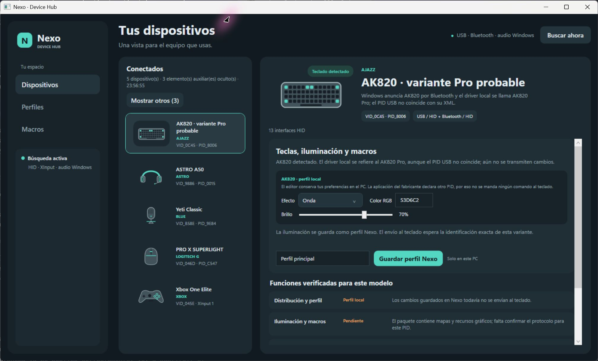

# Nexo Device Hub

Un solo panel para explorar y configurar periféricos de distintas marcas desde Windows.



> **Estado:** prototipo funcional, versión 0.3.0. Algunas funciones actúan sobre Windows y otras solo guardan perfiles locales de Nexo. La ficha de cada dispositivo indica qué está disponible.

## Qué puedes hacer

- **Reunir tus dispositivos:** Nexo combina la información de HID, XInput y audio de Windows, agrupa interfaces relacionadas y oculta receptores y nodos auxiliares hasta que pulses **Mostrar otros**.
- **Ver entradas en directo:** el mando Xbox One Elite muestra botones, sticks y gatillos mientras está seleccionado. Puedes ajustar localmente los umbrales LT/RT.
- **Crear macros por software:** graba teclas, clics y rueda, y asigna la secuencia a los botones laterales 4 o 5 del ratón. Nexo debe permanecer abierto para reproducirlas.
- **Guardar perfiles de Nexo:** conserva valores editables en el PC, incluidos los niveles DPI y polling de Logitech, colores por tecla de AJAZZ y curvas del mando.
- **Controlar endpoints de audio de Windows:** cambia el nivel de entrada o salida disponible para Yeti Classic y ASTRO A50.
- **Consultar perfiles ASTRO:** importa, revisa y exporta copias de perfiles `.agp` y `.astroeq`.

## Dispositivos reconocidos en el equipo de desarrollo

La detección depende del hardware conectado y de los nombres que presente Windows. Los siguientes resultados describen el equipo donde se desarrolló Nexo; no garantizan que todos los modelos tengan las mismas funciones.

| Dispositivo | Funciones disponibles en Nexo |
| --- | --- |
| ASTRO A50 Wireless | Niveles de los endpoints de audio de Windows; biblioteca local de perfiles ASTRO. |
| Yeti Classic | Niveles de entrada y salida de audio de Windows. |
| Logitech G PRO Wireless | Editor de perfil local para niveles DPI y polling. La detección usa el receptor C539 y el nombre PnP `PRO WIRELESS`; Nexo todavía no envía esos ajustes al ratón. |
| Xbox One Elite | Estado XInput en directo y umbrales locales de LT/RT. |
| AJAZZ AK820 | Mapa de teclado de 81 teclas, previsualización de color por tecla y perfil local. El PID detectado difiere de los identificadores del paquete AK820 Pro; consulta el análisis antes de asumir compatibilidad. |

Los dispositivos HID que Nexo todavía no conoce pueden aparecer como interfaces genéricas en **Mostrar otros**. La detección por sí sola no implica que puedan configurarse.

## Persistencia y límites actuales

Los perfiles de Nexo se guardan en:

```text
%LOCALAPPDATA%\NexoHub\DeviceProfiles
```

Las macros se guardan en `%LOCALAPPDATA%\NexoHub\macros.json`. Por tanto, estos perfiles permanecen en el PC. **La versión actual todavía no escribe DPI, polling, ecualización, iluminación ni perfiles en la memoria integrada o firmware de los periféricos.** Los cambios de volumen actúan sobre los endpoints de audio de Windows.

Las macros también se ejecutan desde el PC y requieren que Nexo esté abierto. La reproducción está desactivada hasta que la inicies; no se graba movimiento del ratón.

## Ejecutar en Windows

Necesitas Windows x64 y el SDK de .NET 10.

```powershell
git clone https://github.com/bryancastanosansegundo5/DeviceHub.git
cd DeviceHub
dotnet run --project .\NexoHub.csproj -c Release
```

Para compilar y ejecutar las comprobaciones del proyecto:

```powershell
dotnet build .\NexoHub.csproj -c Release
dotnet run --project .\checks\NexoHub.Checks\NexoHub.Checks.csproj -c Release
```

Para crear un ejecutable autónomo de Windows x64:

```powershell
dotnet publish .\NexoHub.csproj -c Release -r win-x64 --self-contained true /p:PublishSingleFile=true -o .\dist
```

El ejecutable publicado y el acceso directo personal de desarrollo no se incluyen en Git. Cada usuario puede generar su propia copia con `dotnet publish`.

## Ingeniería inversa y seguridad

Los análisis disponibles están en [`docs/`](docs/). Recogen observaciones del equipo, recursos de controladores y hallazgos estáticos de ASTRO Command Center. Las inferencias se identifican como tales.

Nexo no envía escrituras HID ni actualizaciones de firmware. Antes de habilitar cambios en el hardware hay que validar el protocolo para el modelo concreto, comprobar la respuesta del dispositivo y releer el valor tras reconectarlo.

## Estructura

- `Adapters/`: capacidades por dispositivo y registro de adaptadores.
- `Services/`: detección, perfiles, audio y macros.
- `ViewModels/`, `Controls/` y `MainWindow.xaml`: lógica y presentación de la aplicación WPF.
- `Assets/`: datos del layout AJAZZ.
- `checks/`: comprobaciones de perfiles, macros y adaptadores.
- `docs/`: notas de identificación y análisis técnico.

## Skills para continuar el desarrollo con Codex

Las skills recomendadas y el objetivo del proyecto están descritos en [`AGENTS.md`](AGENTS.md). REA (`reverse-engineer-anything`) se usa cuando una tarea requiera investigar binarios, protocolos o comportamiento de dispositivos; `ponytail` para cambios de código y `frontend-design` para trabajo de interfaz.
